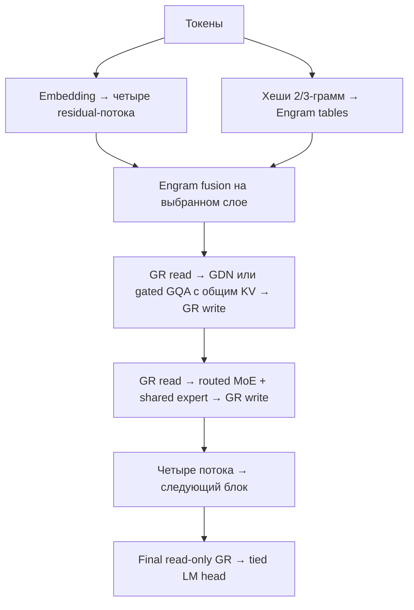

# Предлагаемая архитектура next-moe v0.3

Обновлено 11 октября 2026 после [исследования DeepSeek-V4.1-Flash](deepseek-v41-review.md). Статус на 12 октября: проект архитектуры и [обучаемый PyTorch-прототип малого профиля для Colab](colab-training.md); полноценное обучение и оценка качества не проведены. Источники и границы подтверждения перечислены в [sources.md](sources.md). Основное изменение v0.3 — один KV source для пары full-attention слоёв; уменьшение памяти рассчитано, влияние на качество ещё не измерено.

## Цель и рабочие предположения

Авторегрессионная текстовая модель для украинского и английского языка. Целевой контекст — 256K (262 144 токена), с поэтапной проверкой 32K → 128K → 256K. Небольшие 2K–8K эксперименты допустимы для отладки компонентов, но не валидируют целевой контекст. Поддержка длины архитектурой не означает сохранения качества на этой длине.

По ответам пользователя архитектура проектируется независимо от GPU и конкретного размера. Требования к редактированию: прямое добавление, замена и удаление строк/векторов обучаемой Engram-памяти. Attention: GDN + редкие full-attention слои с растущим KV. Размерности, число слоёв/экспертов и строк — параметры будущего конструктора; приведённые ниже профили только иллюстрируют формулы. Gated Residual (GR) включён в основной граф: четыре ветви, отдельные read/write operators для attention и MoE. Мультимодальность, MTP и альтернативы GR (mHC/AttnRes) отложены до сравнительных экспериментов.

Уточнённое требование к кешу: уменьшить объём по сравнению с all-full attention; рост с контекстом допустим и ожидаем. Фиксированный общий кеш не является целью. Сохраняем полный causal KV prefix глобальных слоёв, без window eviction. [Обзор других n-gram моделей и решение по второму модулю](ngram-placement-review.md): один ранний модуль по умолчанию, второй — исследовательская опция.

Актуальное предложение размеров: [десять профилей от 0.2B + 0.1B до 1T + 200B](model-family.md), с одним Engram-модулем и отдельными neural/active/table counts. [Современные референсы размеров](model-size-references.md) и [JSON-конфигурации](../configs/model-family.json) пересчитаны 11 октября для shared KV. Два примера ниже сохраняются как прежние иллюстрации v0.2 для J=2 без KV-sharing.

MoE экономит вычисления на токен относительно плотной модели сопоставимой общей ёмкости. Все эксперты всё равно необходимо хранить: на GPU, на нескольких GPU или с переносом в RAM. Offload экспертов зависит от динамической маршрутизации и может сильно увеличивать задержку. Сравнение с dense-моделью того же количества активных параметров может оказаться не в пользу MoE по памяти и скорости.

Гибридное attention уменьшает память состояния контекста. Engram увеличивает общую ёмкость параметров, но позволяет отдельно размещать таблицы в RAM; эта память не исчезает из общего бюджета системы.

## Что берём из источников

| Источник | Проверенная идея | Решение для проекта |
| --- | --- | --- |
| Gemma 4 26B-A4B | MoE 128 экспертов, top-8 и общий MLP; local/full attention 5:1; отдельная конфигурация глобальных KV | Общий эксперт, сравнительный вариант local/full; K=V оставить отдельным экспериментом |
| GPT-OSS | Sparse MoE, alternating sliding/full attention, GQA; MXFP4 для MoE-весов | Раздельная точность экспертов и остальных блоков; измерять качество квантования |
| Qwen3.8-Flash-Next | Официальный README и technical report: preview архитектуры Qwen4; GDN/QSA, Gated Residual, n-gram embedding и host prefetch | GDN + full GQA; GR с четырьмя ветвями в основном графе; QSA как последующий эксперимент |
| Engram | Детерминированный multi-head hash lookup коротких n-грамм, context-aware gating, convolution, host-memory prefetch | Параметризуемое размещение модулей; старт с одного раннего, сравнение с двумя |
| DeepSeek-V4.1-Flash | CSA2 с явными KV sources, CED, Single-Pass mHC, Engram; проверены card/config/inference code | Общий BF16 KV для пар full GQA включён в v0.3; CED, sparse indexing, FP4 KV и новый mHC остаются сравнительными вариантами |

Эта комбинация — инженерная гипотеза. В прочитанных источниках не установлено, что именно такой состав блоков, эти размеры или будущие изменения памяти дают улучшение качества. Готовые веса перечисленных моделей нельзя просто объединить в эту архитектуру: различаются токенизаторы, формы тензоров и распределения скрытых состояний.

## Вычислительный граф

Состояние `R:[B,T,n,d]`, начальное n=4. Attention и MoE по-прежнему работают с шириной d, а каждый GR operator читает все ветви через channel-wise gates и записывает результат через scalar gate каждой ветви. Подробные уравнения, источники и сравнительные варианты — в [residual-design.md](residual-design.md).

Engram присутствует только на выбранных слоях; старт — второй decoder block. Новый порядок:

1. На слоях памяти: `R ← R + Engram(tokens,R)`; branch-specific keys/gates, shared value.
2. `x,s = GR_attention.read(R)`; `y=Mixer(x)`; `R_i ← R_i + s_i*y`.
3. `x,s = GR_moe.read(R)`; `y=SharedMLP(x)+sum_j router_weight_j*Expert_j(x)`; `R_i ← R_i + s_i*y`.

`GR.read` включает per-branch normalization. Прежний дополнительный pre-RMSNorm между GR read и Mixer/MLP удалён. На выходе final read-only GR сводит ветви к d перед LM head; отдельный прежний final RMSNorm не используется. Внутренние Q/K/GDN norms сохраняются.

Число ветвей n и gate rank rho параметризуются; начально n=4 и rho=d/8. GR — выбранная residual-схема, не добавочная матрица H_res из mHC и не attention по истории предыдущих слоёв из AttnRes. Таблицы Engram и KV не дублируются по ветвям.

Два mixer-типа: Gated DeltaNet с каузальной depthwise convolution и gated GQA с RoPE. Начальный шаблон `[GDN, GDN, GDN, GQA]`, последний слой — GQA; доля и расположение full layers параметризуются. GQA-гейт по каналам выхода — отдельная проекция размера `d × (Hq * dh)`. K и V остаются разными тензорами; в v0.3 они совместно используются парой последовательных global слоёв.

**KV ownership:** full layers `[4,8,12,16,...]` (1-based) читают источники `[4,4,12,12,...]`. Source строит K/V из собственного GR attention read; reader сохраняет свои Q/gate/output projections, но не имеет собственных K/V projections. Непарный последний full слой — самостоятельный source. Различные queries выполняют dense full attention по общей памяти всех causal token positions. Это cross-layer attention, а не идентичный исходному unshared граф; нужен training с этой схемой. Группы имеют общие head dims, RoPE/position IDs и KV dtype. Source записывает новый токен один раз; reader не дописывает и не копирует cache. Source K/V получают gradient от обоих слоёв. [Разбор и примеры](deepseek-v41-review.md).

Prefill по-прежнему проходит все GDN/GQA и MoE слои. CED skip-prefill из V4.1 не включён: decoder GDN требует корректного recurrent state всего префикса, а bounded SWA replay его в общем случае не восстанавливает. Global KV prefix сохраняется полностью; sharing не вводит eviction или pooling.

GDN хранит матрицу состояния на head, `S ∈ R^(dk × dv)`: `S_decay = alpha * S_old`, `error = v - S_decay^T*k`, `S_new = S_decay + beta*k*error^T`, `y = S_new^T*q`. Q/K проходят L2-normalization; decay/write gates и output gate — обучаемые. По Flash-Next используем bounded sigmoid output gate, а zero-centered RMSNorm проверяем отдельной абляцией. Recurrent state считать в FP32, остальные activation dtypes выбирать по реализации. Это сжатая память контекста с обученными правилами обновления, не долговременная Engram-таблица.

QSA не включён в основной граф по выбору пользователя. Он выбирает блоки истории по compressed indexer и уменьшает attention computation; это не доказательство фиксированного KV-кеша. Его indexer всё ещё имеет `O(T²/r)` prefill cost при фиксированном размере micro-block `r`. Full KV нельзя удалять без отдельного механизма retention, так как будущий запрос может выбрать ранее неиспользованные токены. При добавлении QSA нужны indexer states, sparse-selection buffers и continued-training warm-up, а не только смена mask.

MoE: SwiGLU без bias, один общий эксперт, top-k routed experts с перенормировкой выбранных вероятностей. Router logits/softmax считать в FP32. Начальный вариант балансировки — auxiliary load-balancing loss; коэффициент подобрать экспериментально. Нужны статистика загрузки, entropy, доля потерянных токенов и контроль collapse. Предпочтителен dispatch без отбрасывания токенов; его временную память включать в замеры.

RMSNorm, RoPE и causal masks входят в спецификацию. Начальные RoPE-параметры и их расширение требуют отдельного эксперимента; увеличивать только число `max_position_embeddings` недостаточно.

## Два прежних примера v0.2: GR, J=2, без KV-sharing

Это архивные примеры расчётов v0.2, не текущая сетка и не выбор под оборудование. В этих численных примерах оставлены два Engram-модуля и независимые KV всех global слоёв. Актуальный baseline J=1 с общими KV sources приведён в [model-family.md](model-family.md).

| Параметр | Малый пример J=2 | Крупный пример J=2 |
| --- | ---: | ---: |
| Слои L | 12 | 32 |
| Ширина d | 512 | 2048 |
| Routed experts E на слой | 16 | 64 |
| Top-k | 2 | 4 |
| Shared experts | 1 | 1 |
| SwiGLU intermediate f каждого эксперта | 512 | 1536 |
| Vocabulary V; tied input/output | 65 536 | 131 072 |
| Full attention: Hq / Hkv / dh | 8 / 2 / 64 | 16 / 4 / 128 |
| GDN: Hk / Hv / dk / dv | 4 / 8 / 64 / 64 | 8 / 16 / 128 / 128 |
| GDN / GQA слои | 9 / 3 | 24 / 8 |
| Engram-слои, индексы с 1 | 2 и 6 | 2 и 16 |
| N-gram orders | 2, 3 | 2, 3 |
| Hash heads на порядок | 4 | 4 |
| Строк в каждой head-таблице | 65 536 | 1 048 576 |
| Размер строки | 32 | 64 |
| GR branches / rank | 4 / 64 | 4 / 256 |
| Параметры GR | ≈6.80M | ≈275.26M |
| Всего параметров, включая таблицы | ≈248M | ≈21.78B |
| Нейросетевые параметры без таблиц | ≈215M | ≈20.71B |
| Активные параметры по соглашению ниже | ≈82.4M | ≈2.59B |
| Таблицы Engram | ≈33.6M | ≈1.074B |

Обозначения конфигурации в JSON: `hq/hkv/dh` относятся к GQA, `hk/hv/dk/dv` — к GDN; `rows/hash_heads/row_dim` — к каждой Engram-таблице. Все слои имеют MoE; размер общего эксперта равен `f`. Два Engram-модуля имеют независимые таблицы и проекции. GDN conv kernel = 4; Engram conv kernel = 4. Индексы Engram-слоёв приведены здесь, JSON хранит основные размерности и оценки.

Выбор словаря предварительный: больший словарь сокращает число токенов некоторых языков, но увеличивает embedding и стоимость полного softmax. Токенизатор и нормализация должны быть неизменными для совместимости таблиц. Сохранение регистра, чисел, украинских апострофов, букв і/ї/є/ґ и границ сущностей требует проверки; необдуманная нормализация создаёт дополнительные коллизии. Базовый вариант не смешивает украинские и русские буквы и не делает stemming; aliases задаются явно. Версию нормализации хранить вместе с памятью.

## Engram и редактирование знаний

Для каждой позиции извлекаем suffix 2/3-граммы только из доступного каузального префикса. Для каждого порядка используем четыре независимых хеш-таблицы. Один lookup даёт конкатенированный `e_t`; значение `v_t=Wv*e_t` общее для residual-ветвей, keys `K_t=Wk*e_t` имеют форму `[n,d]`.

Каждая ветвь нормализует свой R_i и key_i, вычисляет dot-product score, signed-square-root transform и sigmoid gate, затем получает `u_i=gate_i*v_t`. Memory update — прямое `U` плюс causal depthwise conv нормализованного U, отдельно по branch channels. Начальные kernel=4 и dilation=3. [Формулы и shape contract](residual-design.md).

Engram-update добавляется к widened R до attention выбранного decoder block. Это адаптация branch-wise memory fusion по Flash-Next; она не вводит отдельный третий GR read/write operator и не дублирует таблицы. Инициализацию memory branch и её нормы/масштабы проверить при обучении; перенос новой ветви в существующий checkpoint требует отдельного warm-start recipe.

Хеши известны после появления входных токенов: для prefill можно вычислить адреса заранее, при decode — после получения следующего токена, до Engram-слоя. Host-memory prefetch и GPU-кеш частых строк исследовать после функциональной реализации. Число хеш-операций постоянно относительно размера таблицы при фиксированном наборе n/head; lookup не означает постоянную физическую задержку RAM/PCIe.

Размещение — исследовательский параметр. В Engram §6.2 при одинаковом бюджете 1.6B один модуль даёт loss 1.770, два — 1.768: небольшой выигрыш в конкретном multi-branch backbone. Flash-Next §2.3.1 не находит устойчивого downstream выигрыша от двух слоёв. LongCat-Flash-Lite и BLT показывают input-memory пути; многослойный N-grammer использует другие, latent keys. Поэтому обязательный второй модуль не включаем; план matched-budget и shared-table экспериментов описан в [обзоре](ngram-placement-review.md). По §2.3.2 Flash-Next уменьшение MoE ради n-gram памяти при фиксированном общем бюджете не даёт ясного downstream выигрыша; нельзя предполагать, что обмен экспертов на таблицы всегда полезен.

**Строка Engram — обученный вектор ассоциаций, а не запись вида «столица страны = город».** Короткие subword n-граммы не выражают произвольное отношение, временную область и длинные имена. Один и тот же hash bucket обслуживает несколько n-грамм; часть знаний остаётся в attention/MLP-весах. Многоязычные парафразы имеют разные ключи.

Выбранное требование — возможность прямого добавления, замены и удаления строк/векторов. На текущем этапе не выбираем формат edit API, exact-key overlay, tombstones, способ получения новых векторов или механизм aliases: пользователь попросил отложить эти детали.

Архитектурный контракт ограничен следующими свойствами: таблицы имеют явную адресацию, отделены от основных весов, доступны для чтения и обновления, а блоки памяти обучаются вместе с моделью. Хеш-коллизии и смысл новых векторов остаются открытыми вопросами будущего этапа. Обновление таблиц должно быть проверяемо по поведению; физическое изменение строки не доказывает замену конкретного факта.

Для будущей реализации важно учитывать версию памяти при использовании vector/KV/GDN caches, поскольку сохранённые состояния уже содержат результат прежних lookup. Конкретные операции и критерии редактирования вернём в план после стабилизации базовой архитектуры. Внешняя база фактов/cross-attention в выбранную архитектуру не входит.

## Формулы параметров

Оценки считаются для заданного выше вычислительного графа. B/M — десятичные параметры, GiB = bytes / 2^30. Включены крупные матрицы, router, GDN conv/scalars, GR operators с branch norm gains и Engram-проекции с тремя group norms. Остальные небольшие GDN/GQA norms и служебные параметры не учтены. Это аналитические оценки, не точный `sum(p.numel())` реализованной модели.

Для одного SwiGLU эксперта `P_expert = 3*d*f`. Тогда `P_routed = L*E*3*d*f`, `P_shared = L*3*d*f`, `P_router = L*d*E`, `P_embed/head = V*d` при tied head. Если отвязать head, добавить ещё `V*d`.

Для gated GQA-слоя: `P_GQA = d*(3*Hq*dh + 2*Hkv*dh)`; третья query-width матрица соответствует output gate. Для GDN обозначим `K=Hk*dk`, `W=Hv*dv`, conv kernel `c=4`:

`P_GDN = d*(2*K + 3*W + 2*Hv) + c*(2*K + W) + 2*Hv + dv`.

Формула P_GQA выше относится к самостоятельному source слою. В v0.3 для одинаковых head dims: `P_full_total = L_full*3*d*Hq*dh + L_kv*2*d*Hkv*dh`, где `L_kv=ceil(L_full/2)` — уникальные KV sources. У reader учтены только Q, output gate и output projection. При неодинаковых размерах суммировать эти части по конкретным слоям/источникам. Суммы neural/active/quantized weights/training states пересчитываются после удаления reader K/V projections.

Для J Engram-модулей, N порядков, H hash heads, Rows строк и D размерности: `P_table=J*N*H*Rows*D`. Ширина конкатенации `m=N*H*D`; branch-wise adapter: `P_memory_adapter=J*((n+1)*m*d + c*n*d + 3*n*d)`. Члены — shared value/branch keys, conv и три group norms. В иллюстрациях J=2, N=2, H=4; baseline J=1.

Если row counts различаются между таблицами, суммировать `P_table=sum_(module,order,head) Rows_i*D_i`. Актуальная десятипрофильная сетка использует восемь различных близких row counts в единственном модуле; среднее число строк не заменяет точный подсчёт.

Для GR: `P_read=2*n*d*rho+n*d`, `P_read_write=P_read+n²*d`, `P_GR=2*L*P_read_write+P_read`. Это два независимых operators на слой и final read-only. Все GR matrices активны на каждом токене; отдельного GR на каждого эксперта нет.

Соглашение активных параметров: все нетабличные матрицы backbone/адаптеров + `k` экспертов в каждом слое + реально выбранные scalars таблиц. Полный tied vocab matrix считать один раз: выходной full softmax использует весь head. `P_active ≈ P_neural - P_routed + L*k*3*d*f + J*N*H*D`. Последний член всего 1024 scalars/token у основного кандидата. Это не FLOPs и не число уникальных строк, прочитанных всем батчем. Активность для softmax и sparse lookup показывать отдельно в конструкторе.

## Память инференса

Актуальные оценки v0.3 для десяти размеров приведены в [model-family.md](model-family.md): BF16 KV на 256K, batch=1 — от 0.250 до 4.500 GiB. Далее сохранены числа прежних двух примеров v0.2 без KV-sharing, чтобы явно отделить сравнение от нового baseline.

Основной кандидат без квантования: нейросетевые веса BF16 ≈38.58 GiB и Engram-таблицы BF16 2.00 GiB. Если все таблицы на GPU, суммировать оба компонента.

Если только routed expert weights упаковать в 4 бита, остальные веса оставить BF16, аналитический нижний предел нейросетевых весов ≈11.58 GiB. Не включены scales, block padding, metadata и временная деквантизация. MXFP4 требует подходящих kernel/backend; неподдерживаемая реализация может разворачивать экспертов в BF16. BF16-гейт, adapter и таблицы сохраняем на первом этапе. Достижение этой границы и качество INT4/MXFP4 ещё не проверены.

При batch B, cached tokens T и BF16 KV:

`M_KV = 2 * B * L_full * T * Hkv * dh * 2 bytes`.

Для baseline v0.3 заменить L_full на число уникальных sources L_kv: `M_KV = 2*B*L_kv*T*Hkv*dh*2 bytes`. Считать реальные cache owners, а не число reader layers. Logical sharing требует поддержки backend; копии на pipeline stages и quantization metadata считать отдельно. Увеличение длины контекста и concurrency по-прежнему линейно увеличивает KV.

Для GDN состояния FP32: `M_GDN = B * L_linear * Hv * dk * dv * 4 bytes`. Буфер causal conv BF16: `B * L_linear * (2*K+W) * (c-1) * 2 bytes` при минимальном хранении истории. Некоторые backend хранят kernel-size slots вместо c-1.

| Основной кандидат, batch=1 | Контекст 8K | Контекст 32K | Контекст 128K |
| --- | ---: | ---: | ---: |
| GQA KV, 8 слоёв | 0.125 GiB | 0.500 GiB | 2.000 GiB |
| GDN recurrent state, 24 слоя | 0.0234 GiB | 0.0234 GiB | 0.0234 GiB |
| GDN conv buffers | 0.00055 GiB | 0.00055 GiB | 0.00055 GiB |
| Engram conv history, J=2, n=4 | 0.000275 GiB | 0.000275 GiB | 0.000275 GiB |
| Сравнение: KV для 32 full GQA слоёв | 0.500 GiB | 2.000 GiB | 8.000 GiB |

На 256K у этого иллюстративного профиля GQA KV = 4.00 GiB при batch=1, вместо 16.00 GiB для 32 full слоёв; recurrent state остаётся ≈0.0234 GiB. Это объём сохранённого состояния, не prefill peak VRAM.

В этих архивных примерах v0.2 KV экономится примерно в четыре раза и остаётся линейным по контексту; в актуальной сетке v0.3 sharing дополнительно уменьшает число owners. Full attention prefill всё ещё имеет квадратичную вычислительную стоимость по T. FlashAttention экономит промежуточную память, но не отменяет эту стоимость. Все состояния масштабируются с количеством одновременно обслуживаемых последовательностей; branch/beam states и speculative decoding добавляют память.

Итого нижний предел при mixed quantization, RAM-таблицах, batch=1 и 32K: ≈12.10 GiB на GPU до scales, GPU-кеша таблиц, GR/live activation buffers, prefill/decode workspace, allocator и runtime. Это иллюстрация расчёта, а не выбор GPU. RAM должна вместить таблицы, загрузку checkpoint, pinned buffers и ОС. Метаданные редактируемой памяти считаются отдельно.

GR не меняет head dimensions, поэтому KV/GDN state не умножается на четыре. Он увеличивает transient residual state: `B*T_live*n*d*bytes`, где T_live — текущий decode шаг или prefill chunk, не вся история KV. При d=2048, BF16 и n=4 один такой буфер на 32K chunk равен 0.50 GiB, на 256K chunk — 4.00 GiB; single-stream буфер соответственно 0.125/1.00 GiB. Это один live tensor, не итоговый peak. Gates, нормализованные ветви и backward activations могут требовать дополнительных буферов. FP8 residual storage не предполагается на первом этапе.

Для Engram conv history с dilation a: `M_Engram_conv=B*J*n*d*(c-1)*a*bytes`. При J=2, n=4, d=2048, c=4, a=3 и BF16 это ≈0.000275 GiB; baseline J=1 имеет вдвое меньше. Сохраняется дополнительно короткий token-prefix buffer для вычисления n-gram keys.

## Память и стоимость обучения

Полное обучение в BF16 с BF16 gradients, FP32 master weights и FP32 Adam moments имеет базовую модель хранения `2+2+4+8 = 16 bytes/parameter`. Реальные optimizer/gradient dtypes могут отличаться. Для иллюстративного полного кандидата с GR ≈324.6 GiB состояний: ≈308.6 GiB нейросетевой части и 16 GiB Engram-таблиц, до activations и временной памяти. Это не прогноз пика VRAM.

Простой unsharded вариант требует хранения всей этой суммы; число активных экспертов не сокращает глобальные optimizer states. ZeRO-3/FSDP/EP и CPU optimizer offload меняют размещение, а не общую ёмкость. Делить всю сумму на число GPU корректно лишь как идеализированную нижнюю границу полного равномерного шардирования; replicated tensors, all-gather, communication buffers и imbalance учитываются дополнительно.

CPU-training таблиц требует реализации gradient transfer, синхронизации и хранения optimizer state. Сам sparse lookup не гарантирует sparse optimizer storage: например, моменты могут занимать память всей таблицы. Training throughput и PCIe могут стать ограничением.

Для иллюстративного прототипа нижняя граница Adam states ≈3.70 GiB, BF16 neural weights ≈0.400 GiB, BF16 таблицы ≈0.0625 GiB. Activations, logits `B*T*V`, attention workspace, MoE dispatch и optimizer temporaries добавляются сверху. Конкретное оборудование сейчас не выбирается; при реализации нужно измерить пик, а не считать эти аналитические компоненты полным расходом памяти.

Для конструктора формула обучения: `M_peak = retained_states + saved_activations + largest_live_workspace + communication + allocator_margin`, с отдельными сценариями full pretrain, LoRA/QLoRA, обучение adapters/таблиц и edit-only. Даже замороженные слои могут требовать backward activations для обучаемых вставок. Измеренные backend-профили важнее единого коэффициента к параметрам.

Обучение новой архитектуры с нуля — отдельный вычислительный бюджет и данные, независимо от того, помещается ли её квантованный инференс на одну GPU. Путь с готовым checkpoint: выбрать совместимый backbone, вставлять Engram с малыми residual contributions и выполнять continued pretraining; изменение attention/MoE не является бесплатным переносом весов. Сейчас оборудование и конечные размеры не выбираем; малые профили служат способом проверить компоненты.

## Критерии выбора

Сравнить одинаковый tokenizer и данные, одинаковый total-parameter budget и отдельно одинаковый compute budget. Проверить dense, MoE, MoE+GDN, MoE+Engram и полный вариант; GR отдельно сравнить с plain pre-norm, single-stream GatedNorm и static widened residual. Для one-vs-two memory modules residual-схема должна быть одинаковой. Оценивать perplexity и downstream качество, точный recall длинного контекста, peak GPU/RAM, time-to-first-token, decode tokens/s, PCIe traffic и устойчивость routing.

GDN может терять точные детали далеко в истории; отношение 3:1 выбрано как исходная точка. Проверять 1:1, 3:1, 7:1 и local/full вариант 5:1 с реальным ограничением sliding-cache backend. Полноценный GQA слой периодически даёт доступ к истории всех токенов, но не гарантирует её использование моделью. Отдельно сравнить KV-sharing group=1/2: у общего source представления токенов строятся на меньшем числе глубин. Проверять recall, gradient receiver→source, prefill/decode equivalence и отсутствие future-token leakage; уменьшение памяти не доказывает сохранение качества.

Редактирование измерять по efficacy, парафразам/языкам UK/EN, unrelated locality, portability к связанным вопросам, последовательным конфликтующим edits, коллизиям, rollback и обновлению cache. Детальный контракт edit-операций пока отложен. Порог допустимой деградации согласовать до оценки результатов. Выбор конкретных размеров отложен; сначала стабилизировать архитектурные контракты и проверить гипотезы.
