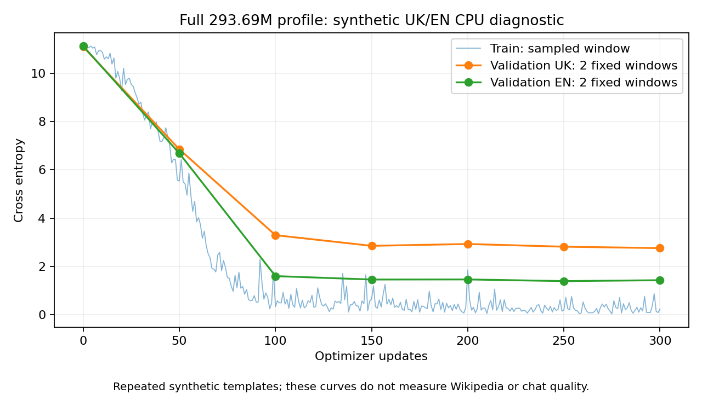

# Проверка обучения полного малого профиля в облачной среде

**12 октября 2026 выполнены 300 optimizer updates полного профиля 0.2B + 0.1B Engram на CPU**, после чего checkpoint восстановлен и выполнен 301-й update. Это diagnostic run на искусственных UK/EN текстах, не обучение на выбранном Wikipedia corpus и не проверка Colab GPU.

## Среда и настройки

GPU отсутствует: нет `/dev/nvidia*` и `nvidia-smi`. CPU: AMD EPYC 9V74, процесс использует четыре потока; PyTorch 2.6.0+cpu. Чтение Wikipedia parquet блокирует сетевой policy для `us.aws.cdn.hf.co`, а официальный rows API — для `datasets-server.huggingface.co` (HTTP CONNECT 403). Proxy/TLS policy не обходился.

Модель: **293 688 272 параметра**, все neural и table параметры обучаемые, исходные 12 × 512 / 16 experts / top-2 + shared, GR × 4, один Engram, GDN/full 3:1 и pairwise shared K/V. FP32 compute/weights/AdamW на CPU, block checkpointing включён, seed 1234.

Последовательность **32**, microbatch **1**, accumulation **1**, 300 updates = **9600 processed training tokens**. Эти настройки отличаются от Colab default 128/1/4 = 153 600 tokens за 300 updates. Результаты нельзя считать выполнением тех же 300 Colab steps.

Искусственный корпус создаёт [cloud_smoke.py](../scripts/cloud_smoke.py): 12 документов на язык, из них 10 train и 2 validation. Это короткие повторяющиеся шаблоны с разными номерами документов, поэтому высокая близость train/validation намеренна для диагностики. Собственный BPE выучил 549 tokens; embedding/head сохраняют полный размер 65 536. Token files: UK train 2830 / val 590, EN train 2710 / val 566. Выбор языка 50/50, окна с возможными повторениями.

## Результаты

| Показатель | Начало | После 300 updates |
| --- | ---: | ---: |
| Training CE sampled window | 11.0834 | 0.2314 |
| Validation CE UK | 11.0979 | 2.7585 |
| Validation CE EN | 11.1270 | 1.4285 |

Training CE — значение одного sampled window, не среднее всей выборки. Validation — два фиксированных окна на язык, не полноценный quality benchmark. Метрики всех 300 updates конечные; full checkpoint записан на 100/200/300 updates и в конце.

Время этих 300 updates, включая evaluation/checkpoint overhead: **389.67 секунды (~6.49 минуты)**. Средняя скорость: **24.64 tokens/s** на коротком CPU-режиме. Peak RSS всего процесса, включая последующую загрузку/checkpoint comparison: **6.27 GiB RAM**, не VRAM и не оценка Colab. Full checkpoint около **3.28 GiB**.

После загрузки проверено побитовое равенство всех model tensors и sampler RNG сохранённому состоянию. Optimizer/scaler states загружены; следующий update выполнен успешно, завершён step 301. Для проверки продолжения total steps увеличен на один, что меняет будущую cosine schedule; это не сравнение двух полностью одинаковых training trajectories. Такое сравнение отдельно проверялось на tiny-профиле автоматическим тестом.



## Сохранённые материалы и воспроизведение

- [Report JSON с параметрами, результатами и source SHA256](../reports/cloud-smoke-2026-10-12/report.json).
- [Метрики всех updates](../reports/cloud-smoke-2026-10-12/metrics.jsonl).
- [Фактические corpus/tokenizer metadata](../reports/cloud-smoke-2026-10-12/data-metadata.json).
- Runtime artifacts и большой checkpoint: `artifacts/cloud-smoke-2026-10-12/run/last.pt`; каталог игнорируется Git, веса не публиковались.

При установленных torch >=2.6 и зависимостях из `requirements-colab.txt` выполнить из корня проекта:

```bash
PYTHONPATH=. python scripts/cloud_smoke.py --steps 300 --sequence-length 32 --output artifacts/new-cloud-smoke
```

Новый output нужен, чтобы не перезаписать предыдущие результаты. Это отдельный диагностический скрипт; основной Colab notebook по-прежнему настроен на открытый [Wikipedia dataset](training-corpus.md), без скрытой подмены данных.

## Что подтверждено

Полный малый граф способен стабильно обучаться на данном коротком диагностическом корпусе; обучение уменьшает loss, full optimizer checkpoint сохраняется/загружается, и training продолжается. Это дополняет девять автоматических correctness checks, включая causality, GDN gradients и shared KV gradients.

Не подтверждены: качество Wikipedia pretraining, chat behavior, полезность каждого компонента относительно baseline, CUDA mixed precision, peak Colab VRAM, GPU throughput и длинный контекст. Низкий loss на повторяющихся шаблонах не меняет вывода: 300 default updates недостаточно для качественного обучения модели с нуля.
